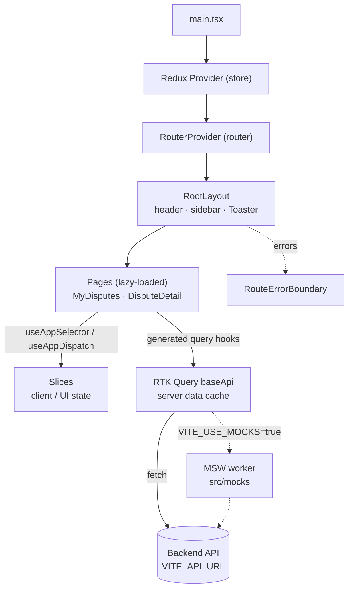

# Card Dispute — Frontend

Web client for the Card Dispute platform. It is a single-page app (SPA) built with React 19 and TypeScript.

## Tech stack

| Area               | Technology                                                                 |
| ------------------ | -------------------------------------------------------------------------- |
| UI                 | [React 19](https://react.dev) + [TypeScript 5](https://www.typescriptlang.org) (strict mode) |
| Build / dev server | [Vite 8](https://vite.dev)                                                 |
| Styling            | [Tailwind CSS v4](https://tailwindcss.com) (via `@tailwindcss/vite`)       |
| Routing            | [React Router v7](https://reactrouter.com) in data mode                    |
| Global state       | [Redux Toolkit 2](https://redux-toolkit.js.org) + React Redux 9            |
| Server data        | RTK Query (part of Redux Toolkit)                                          |
| Mock API           | [MSW v3](https://mswjs.io) (browser worker in dev, Node server in tests)  |
| Tests              | [Vitest](https://vitest.dev) + Testing Library + jsdom                     |

## Requirements

- **Node.js 22.13 or newer** (Node 24 LTS recommended). Vite, Vitest and jsdom need this version. Check with `node -v`.
- **npm 10+** (comes with Node).
- The backend is **not** required to run the app yet: the dispute endpoints are served by MSW mocks.

## Getting started

```bash
cd frontend
npm install          # install dependencies
cp .env.example .env.local   # optional: set the backend URL
npm run dev          # open http://localhost:3000
```

With no `.env.local` the app talks to `/api` and finds nothing. To run against the bundled mock API, set `VITE_USE_MOCKS=true` in `.env.local` (or `frontend/.env`) — the MSW browser worker then serves the dispute endpoints.

### Environment variables

Vite only exposes variables that start with `VITE_`. Put local values in `.env.local`; it is not committed.

| Variable          | Default | Description                                                            |
| ----------------- | ------- | ---------------------------------------------------------------------- |
| `VITE_API_URL`    | `/api`  | Base URL for all backend API calls. Endpoint paths add the `v1/` prefix. |
| `VITE_USE_MOCKS`  | `false` | Set to `true` to serve the API from the MSW browser worker.            |

`.env.test` is committed: Vitest runs in `test` mode, and the absolute `VITE_API_URL` it sets is required because Node's `fetch` rejects relative URLs.

## Scripts

| Command             | What it does                                         |
| ------------------- | ---------------------------------------------------- |
| `npm run dev`       | Start the dev server on http://localhost:3000        |
| `npm run build`     | Type-check and build for production into `dist/`     |
| `npm run preview`   | Serve the production build locally                   |
| `npm test`          | Run tests in watch mode (`npm test -- --run` runs once) |
| `npm run test:run`  | Run the whole test suite once and exit               |
| `npm run typecheck` | Type-check only                                      |

## Project structure

```
frontend/
  index.html                 # HTML entry; loads src/main.tsx
  vite.config.ts             # Vite, Tailwind, the @/ alias and Vitest config
  .env.example               # Template for environment variables
  .env.test                  # Committed env for Vitest (absolute API URL)
  public/                    # Static files copied as-is (favicon, manifest…)
  src/
    main.tsx                 # Mounts <Provider store> → <RouterProvider router>
    index.css                # Tailwind import + base styles
    setupTests.ts            # Vitest setup: jest-dom + MSW server lifecycle
    types/                   # Domain types shared by the API layer and pages
      dispute.ts             #   Dispute, DisputeStatus, TimelineEvent, ProblemDetails…
    config/
      demoSession.ts         #   Temporary demo identity header (stub until SSO)
    utils/
      format.ts              #   Amount, date and date-time formatting
      apiError.ts            #   Problem Details → customer-facing message
    routes/                  # Routing
      paths.ts               #   URL constants
      routes.tsx             #   Route tree (RouteObject[])
      router.tsx             #   createBrowserRouter(routes)
    layouts/
      RootLayout.tsx         # Shared shell: header, sidebar, <Outlet />, toasts
    pages/                   # One component per screen
      MyDisputesPage.tsx     #   Customer tracking list
      DisputeDetailPage.tsx  #   Case status, decision, facts, timeline
    components/
      ui/                    # Generic primitives (no domain knowledge)
        Badge.tsx  Timeline.tsx  Lifecycle.tsx  Facts.tsx  StateBlock.tsx  Spinner.tsx
      disputes/              # Dispute domain components
        StatusBadge.tsx  DisputeTimeline.tsx  DisputeLifecycle.tsx
        DisputeDecisionSummary.tsx  DisputeFacts.tsx  meta.ts  lifecycle.ts
    mocks/                   # MSW mock API
      fixtures.ts            #   Deterministic demo cases and timeline events
      handlers.ts            #   Route handlers + exported path predicates
      browser.ts             #   Browser worker (dev)
      server.ts              #   Node server (tests)
    store/                   # Global state
      store.ts               #   makeStore, combineSlices, RootState / AppDispatch
      hooks.ts               #   Typed hooks: useAppSelector, useAppDispatch
      index.ts               #   Public exports (import from "@/store")
      api/
        baseApi.ts           #   RTK Query API (base URL from VITE_API_URL)
        disputesApi.ts       #   Dispute endpoints (list, detail, timeline)
      slices/ui/uiSlice.ts   #   UI state: sidebar and toast notifications
    test/
      renderWithProviders.tsx # Renders the app with a fresh store + memory router
```

Imports can use the `@/` alias for `src/` (for example `import { store } from '@/store'`).

## Architecture



### Routing

- Every route is a child of `RootLayout`, so the header and sidebar stay on every screen.
- Pages are loaded only when visited (the route's `lazy` property), so each page is its own bundle chunk.
- The `*` route shows `NotFoundPage`. If a route throws, `RouteErrorBoundary` is shown.
- Links use the constants in `paths.ts` instead of hard-coded URLs.

### State management

The store keeps two kinds of data apart:

- **Server data** (disputes, users…) lives in the **RTK Query** cache. `baseApi.ts` is the single API; each feature adds its endpoints with `baseApi.injectEndpoints(...)` and uses the hooks it generates (for example `useGetDisputesQuery`).
- **Client state** (UI, preferences) lives in **slices**. `uiSlice.ts` is the pattern to copy; register new slices in `combineSlices(...)` in `store.ts`.

Always use the typed hooks `useAppSelector` / `useAppDispatch` from `@/store`, not the plain react-redux ones.

### Styling

- Styles are Tailwind utility classes written directly in `className`. `index.css` only imports Tailwind and sets base styles for `body`.
- Tailwind resets browser defaults, so headings, links and buttons need explicit classes.
- Write full class names. Tailwind can't detect names built from strings at runtime (`bg-${color}-600`). Map values to full class names instead, as `Toaster.tsx` does for toast variants.

### Mock API

The backend has no REST controllers yet, so the frontend is built **contract-first** against MSW.

- `src/mocks/handlers.ts` holds the route handlers. Paths are **regular expressions** (`DISPUTES_PATH`, `DISPUTE_PATH`, `TIMELINE_PATH`) so a handler matches whatever origin the API base URL points at.
- `src/mocks/fixtures.ts` holds the demo cases. Fixtures are deterministic: fixed UUIDs and ISO timestamps, no `new Date()` and no `Math.random()`.
- `src/mocks/browser.ts` is the dev worker. `main.tsx` starts it before the first render when `VITE_USE_MOCKS=true`, and only then.
- `src/mocks/server.ts` is the Node server used by the tests. Its lifecycle lives in `src/setupTests.ts`: `server.listen({ onUnhandledRequest: 'error' })` before each test, `server.resetHandlers()` after each test, `server.close()` when the file ends.
- A test overrides a route with `server.use(http.get(DISPUTES_PATH, ...))` using the exported predicates.
- The wire format is documented in `docs/api/disputes-contract.md`. That document is the proposal handed to the backend team; the mocks follow it exactly.

### Component conventions

- **Children first.** A component takes `children` and renders them; the parent decides what goes inside.
- **No boolean props** for rendering decisions. Use `children`, a variant prop with a real value (`tone`, `status`) or a dedicated component.
- **No `renderX` props.** Compose instead of passing callbacks that return elements.
- **React 19.** No `forwardRef`; `ref` is a normal prop.
- **Accessible semantics.** Real `<button>`, `<table>`, `<dl>`, `<ol>` and `<ul>` elements with headings and `aria-label`s, so the tests can query by role.
- **Layers.** `components/ui/` holds generic primitives with no domain knowledge; `components/disputes/` holds the dispute-specific components built on top of them.

### Testing

- Test files sit next to the code they test (`*.test.ts` / `*.test.tsx`).
- `renderWithProviders({ route, preloadedState })` renders the full app with a fresh store and an in-memory router, and returns `{ store, router, ... }`.
- Slice logic can be tested without React by dispatching actions to `makeStore()`.
- MSW answers every request in tests. An unhandled request fails the test (`onUnhandledRequest: 'error'`).

## Adding a feature (example: "Disputes")

1. Create the page in `src/pages/` and add its URL to `src/routes/paths.ts`.
2. Add a child route in `src/routes/routes.tsx` using `lazy`.
3. Add the API endpoints with `baseApi.injectEndpoints(...)` and use the generated hooks in the page.
4. If the feature needs its own client state, add a slice under `src/store/slices/` and register it in `store.ts`.
5. Add tests using `renderWithProviders`.
6. Update the mock handlers so the feature can be used without a backend.

## Implemented slices

| Slice | Routes | Status |
| ----- | ------ | ------ |
| Customer dispute tracking (Increment 1, POC-08) | `/disputes`, `/disputes/:id` | Done — mocked API, contract in `docs/api/disputes-contract.md` |
| Customer dispute submission | `/disputes/new` | Not started (needs `POST /api/v1/disputes`) |
| Analyst workspace | `/analyst` | Not started |
