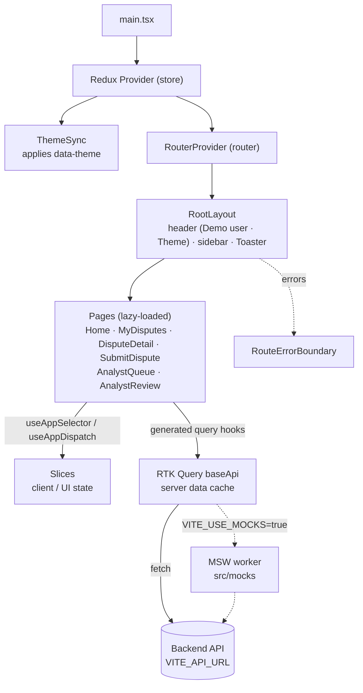

# Card Dispute — Frontend

Web client for the Card Dispute platform. It is a single-page app (SPA) built with React 19 and TypeScript.

**What works today:** customers report a possible duplicate charge, follow their cases (list, detail, live status), switch between synthetic demo users and pick a light or dark theme. Every screen runs against the MSW mock API; the backend wiring is in place, with the gaps listed in [Known gaps with the real backend](#known-gaps-with-the-real-backend). The analyst workspace is not built yet.

## Tech stack

| Area               | Technology                                                                 |
| ------------------ | -------------------------------------------------------------------------- |
| UI                 | [React 19](https://react.dev) + [TypeScript 5](https://www.typescriptlang.org) (strict mode) |
| Build / dev server | [Vite 8](https://vite.dev)                                                 |
| Styling            | [Tailwind CSS v4](https://tailwindcss.com) (via `@tailwindcss/vite`)       |
| Routing            | [React Router v7](https://reactrouter.com) in data mode                    |
| Global state       | [Redux Toolkit 2](https://redux-toolkit.js.org) + React Redux 9            |
| Server data        | RTK Query (part of Redux Toolkit)                                          |
| Mock API           | [MSW v3](https://mswjs.io) (browser worker in dev, Node server in tests)  |
| Tests              | [Vitest](https://vitest.dev) + Testing Library + jsdom                     |

## Requirements

- **Node.js 22.13 or newer** (Node 24 LTS recommended). Vite, Vitest and jsdom need this version. Check with `node -v`.
- **npm 10+** (comes with Node).
- For the real backend: **Docker** (SQL Server + Camunda), **JDK 21** and the backend module (see [Running against the backend](#running-against-the-backend)). The app can also run alone against MSW mocks.

## Getting started

```bash
cd frontend
npm install
cp .env.example .env.local   # VITE_API_URL=http://localhost:8080/api
npm run dev                  # open http://localhost:3000
```

The app signs in against the backend, so nothing works until the backend is up. To run without a backend, set `VITE_USE_MOCKS=true` in `.env.local` — the MSW browser worker then serves the customer endpoints, the analyst endpoints and the demo accounts.

### Environment variables

Vite only exposes variables that start with `VITE_`. Put local values in `.env.local`; it is not committed.

| Variable          | Default | Description                                                            |
| ----------------- | ------- | ---------------------------------------------------------------------- |
| `VITE_API_URL`    | `/api`  | Base URL for all backend API calls. Endpoint paths add the `v1/` prefix. |
| `VITE_USE_MOCKS`  | `false` | Set to `true` to serve the API from the MSW browser worker.            |
| `VITE_DEMO_PASSWORD` | `demo` | Password of the synthetic demo users (see "Demo users" below).       |
| `BACKEND_URL`     | `http://localhost:8080` | Target of the dev server `/api` proxy. Not exposed to the browser. |

`.env.test` is committed: Vitest runs in `test` mode, and the absolute `VITE_API_URL` it sets is required because Node's `fetch` rejects relative URLs.

## Scripts

| Command             | What it does                                         |
| ------------------- | ---------------------------------------------------- |
| `npm run dev`       | Start the dev server on http://localhost:3000        |
| `npm run build`     | Type-check and build for production into `dist/`     |
| `npm run preview`   | Serve the production build locally                   |
| `npm test`          | Run tests in watch mode (`npm test -- --run` runs once) |
| `npm run test:run`  | Run the whole test suite once and exit               |
| `npm run typecheck` | Type-check only                                      |

## Project structure

```
frontend/
  index.html                 # HTML entry; loads src/main.tsx
  vite.config.ts             # Vite, Tailwind, the @/ alias and Vitest config
  .env.example               # Template for environment variables
  .env.test                  # Committed env for Vitest (absolute API URL)
  public/                    # Static files copied as-is (favicon, manifest…)
  src/
    main.tsx                 # Mounts <Provider store> → <RouterProvider router>
    index.css                # Tailwind import + base styles
    setupTests.ts            # Vitest setup: jest-dom, MSW server, <dialog>/matchMedia stubs, per-test reset
    types/                   # Domain types shared by the API layer and pages
      dispute.ts             #   Dispute, DisputeStatus, TimelineEvent, ProblemDetails…
      transaction.ts         #   Transaction, CreateDisputeRequest
      api.ts                 #   PageResponse (backend page shape), ApiProblem
      analyst.ts             #   AnalystTask, AnalystTaskPage, MatchAssessment, queues…
    config/
      apiMode.ts             #   isMockApi: read once from VITE_USE_MOCKS
      demoSession.ts         #   Demo accounts, Basic header, mock identity headers
      demoUsers.ts           #   Synthetic demo users + Basic auth headers
      theme.ts               #   Theme storage, OS setting, applyTheme
    utils/
      format.ts              #   Amount, date and date-time formatting
      apiError.ts            #   Problem Details → customer-facing message
      submitErrors.ts        #   Submit form validation + error → form message mapping
    routes/                  # Routing
      paths.ts               #   URL constants
      routes.tsx             #   Route tree (RouteObject[])
      router.tsx             #   createBrowserRouter(routes)
    layouts/
      RootLayout.tsx         # Shared shell: header, sidebar, <Outlet />, toasts
    pages/                   # One component per screen
      HomePage.tsx           #   Landing page
      NotFoundPage.tsx       #   404 for unknown URLs
      LoginPage.tsx          #   Demo username/password sign-in
      ForbiddenPage.tsx      #   Wrong role for the requested area
      MyDisputesPage.tsx     #   Customer tracking list
      DisputeDetailPage.tsx  #   Case status, decision, facts, timeline (refreshes while open)
      SubmitDisputePage.tsx  #   Report a possible duplicate charge
      AnalystQueuePage.tsx   #   Analyst work queue (pending / due soon)
      AnalystReviewPage.tsx  #   Task evidence, decision form, history
    components/
      auth/                  # RequireAuth, RequireRole route guards
      ui/                    # Generic primitives (no domain knowledge)
        Badge.tsx  Timeline.tsx  Lifecycle.tsx  Facts.tsx  StateBlock.tsx  Spinner.tsx
        ConfirmDialog.tsx    # Modal confirmation (native <dialog>)
        Button.tsx  Field.tsx
      disputes/              # Dispute domain components
        StatusBadge.tsx  DisputeTimeline.tsx  DisputeLifecycle.tsx
        DisputeDecisionSummary.tsx  DisputeFacts.tsx  TransactionFacts.tsx
        meta.ts  lifecycle.ts
      session/
        DemoUserPicker.tsx   # Header menu to switch the demo user
      theme/
        ThemePicker.tsx      # Header Theme menu (Light / Dark / System)
        ThemeSync.tsx        # Applies and saves the theme; follows the OS setting
      analyst/               # Analyst domain components
        AnalystQueueTabs.tsx  AnalystQueueTable.tsx  AnalystEvidence.tsx
        AnalystDecisionForm.tsx  AnalystDecisionPanel.tsx  AnalystDecisionOutcome.tsx
        meta.ts  errors.ts
    mocks/                   # MSW mock API
      fixtures.ts            #   Deterministic transactions, cases, tasks and timeline events
      handlers.ts            #   Route handlers + exported path predicates
      browser.ts             #   Browser worker (dev)
      server.ts              #   Node server (tests)
    store/                   # Global state
      store.ts               #   makeStore, combineSlices, RootState / AppDispatch
      hooks.ts               #   Typed hooks: useAppSelector, useAppDispatch
      index.ts               #   Public exports (import from "@/store")
      api/
        baseApi.ts           #   RTK Query API (URL, Basic auth, 401 → sign out)
        authApi.ts           #   Credential check before opening the session
        disputesApi.ts       #   Dispute endpoints (list, detail, timeline)
        disputeSubmissionApi.ts #  POST /disputes (submit a dispute)
        transactionsApi.ts   #   Customer transactions (list, detail)
        analystApi.ts        #   Analyst endpoints (queue, task, decision)
      slices/auth/authSlice.ts #   Signed-in user, role, access rules
      slices/ui/uiSlice.ts   #   UI state: sidebar, toasts and theme
      slices/session/sessionSlice.ts # Current demo user
      slices/session/switchDemoUserAndReset.ts # User switch with soft reset
    test/
      renderWithProviders.tsx # Renders the app with a fresh store + memory router
      matchMedia.ts          # Controllable matchMedia (OS dark mode) for tests
```

Imports can use the `@/` alias for `src/` (for example `import { store } from '@/store'`).

## Architecture



### Routing and access

- `/login` is public. Every other route sits behind `RequireAuth`, then inside `RootLayout`, so the header and sidebar stay on every screen.
- `RequireRole` separates the two areas: `CUSTOMER` may open `/disputes` and `/disputes/:id`; `DISPUTE_ANALYST` may open `/analyst` and `/analyst/tasks/:taskId`. A signed-in user on the other area's URL gets `ForbiddenPage`; an anonymous visitor is sent to `/login` and returned to the requested page after signing in.
- `RootLayout` renders only the navigation of the current role and a **Sign out** action that clears the session.
- Pages are loaded only when visited (the route's `lazy` property), so each page is its own bundle chunk.
- The `*` route shows `NotFoundPage`. If a route throws, `RouteErrorBoundary` is shown.
- Links use the constants in `paths.ts` instead of hard-coded URLs.

### State management

The store keeps two kinds of data apart:

- **Server data** (disputes, users…) lives in the **RTK Query** cache. `baseApi.ts` is the single API; each feature adds its endpoints with `baseApi.injectEndpoints(...)` and uses the hooks it generates (for example `useGetDisputesQuery`, `useGetAnalystTasksQuery`).
- **Client state** lives in **slices**, registered in `combineSlices(...)` in `store.ts`:
  - `uiSlice`: sidebar, toasts and theme (`themePreference`, `systemPrefersDark`)
  - `sessionSlice`: the current demo user

  `uiSlice.ts` is the pattern to copy for a new slice.

Always use the typed hooks `useAppSelector` / `useAppDispatch` from `@/store`, not the plain react-redux ones.

### Demo users

The backend authenticates synthetic users with **HTTP Basic** and takes the customer from the signed-in user, never from the request body.

- `src/config/demoUsers.ts` lists the users from the backend `application.yml` (`customer01`, `customer02`). The password comes from `VITE_DEMO_PASSWORD`.
- `sessionSlice` holds the current user (default `customer01`). `baseApi` adds `Authorization: Basic …` to every request.
- `DemoUserPicker` in the header asks for confirmation (`ConfirmDialog`) before switching. On confirm the app **soft-resets**:
  - it moves to the home page (replacing the current history entry), so open pages and form entries are gone
  - `switchDemoUserAndReset` clears the RTK Query cache (data, polling, in-flight requests), toasts and the sidebar state, then shows a single "Now using …" toast
  - the theme is kept: it is a device setting, not part of a user's session
- **New slices holding session data must reset themselves on `switchDemoUser`** (with `extraReducers`, as `uiSlice` does), so nothing from one user is left for the next.
- The mock API reads the same header to scope its data (`mockCustomerId`).

### Authentication

- `LoginPage` validates the form, then `authApi.verifyCredentials` checks the account. In mock mode the check is local; against the backend it sends a Basic `GET /api/v1/disputes?size=1` probe and treats `401`/`403` as a wrong password.
- On success the session (`username`, `password`, `displayName`, `role`, `customerId`) goes to the `auth` slice and to `sessionStorage`, and the user lands on their role's home.
- `baseApi` attaches the Basic header to every request. A `401` dispatches `signedOut()`, so an expired/revoked session returns to `/login` instead of leaving an empty page.

### Analyst workspace

The analyst area is real UI over **mock** endpoints: the backend still has no `/api/v1/analyst/*` routes. Against the backend those pages skip their queries and show a "not connected" state instead of failing.

The analyst identity travels in the `X-Demo-Analyst-Id` header, attached **per endpoint** (`src/store/api/analystApi.ts`) and only in mock mode, because the customer endpoints must not claim an analyst identity.

- `GET /api/v1/analyst/tasks` — the work queue. `?queue=PENDING` or `?queue=DUE_SOON`; the response carries the size of both queues, so the tab counters need no second request.
- `GET /api/v1/analyst/tasks/{taskId}` — the task with its evidence, the match assessment and a short history. One request, no waterfall.
- `POST /api/v1/analyst/tasks/{taskId}/decision` — `{ decision, rationale }`. The decision is mandatory and the rationale is validated in the browser and again on the server.

The decision invalidates the RTK Query tags `AnalystTask` (the queue) and `Dispute` (the customer views), so the customer sees the outcome without a reload.

### Styling

- Styles are Tailwind utility classes written directly in `className`. `index.css` only imports Tailwind and sets base styles for `body`.
- Tailwind resets browser defaults, so headings, links and buttons need explicit classes.
- Write full class names. Tailwind can't detect names built from strings at runtime (`bg-${color}-600`). Map values to full class names instead, as `Toaster.tsx` does for toast variants.
- **Every color class needs its `dark:` partner** (see "Theme / dark mode" below).

### Theme / dark mode

- The **Theme** menu in the header offers Light, Dark and System. System (the default) follows the OS setting, also when it changes while the app is open.
- State lives in `uiSlice`: `themePreference` (the choice) and `systemPrefersDark` (the OS setting). `selectResolvedTheme` gives the theme actually shown.
- `ThemeSync` (mounted next to the router in `main.tsx` and in `renderWithProviders`) sets `data-theme` on `<html>`, saves the choice in `localStorage` (`card-dispute.theme`) and listens to the OS setting.
- `index.css` ties Tailwind's `dark:` variant to `data-theme`. A small script in `index.html` applies the saved theme before the first paint, so there is no white flash. It repeats the rules in `src/config/theme.ts`; keep them in sync.
- Add a `dark:` class next to each color, using this mapping:

| Light | Dark partner |
| --- | --- |
| `bg-white` | `dark:bg-gray-900` |
| `bg-gray-50` / `bg-gray-100` | `dark:bg-gray-800` |
| `text-gray-900` / `-700` / `-600`, `-500` | `dark:text-gray-100` / `-300` / `-400` |
| `border-gray-200` / `-300` | `dark:border-gray-700` |
| Tints `bg-{c}-50`, `border-{c}-200`, `text-{c}-700/800/900` | `dark:bg-{c}-950/40`, `dark:border-{c}-800`, `dark:text-{c}-300` |
| Links `text-blue-600/700` | `dark:text-blue-400` / `dark:text-blue-300` |
| Solid buttons and toasts (`bg-*-600 text-white`) | none needed |

  Tone colors (badges, timeline, lifecycle) already include their dark classes in `components/ui/tone.ts`.

### Mock API

The frontend is built **contract-first** against MSW, so screens work before the backend endpoints are ready.

- `src/mocks/handlers.ts` holds the route handlers. Paths are **regular expressions** (`DISPUTES_PATH`, `DISPUTE_PATH`, `TIMELINE_PATH`, `TRANSACTIONS_PATH`, `TRANSACTION_PATH`, `ANALYST_TASKS_PATH`, `ANALYST_TASK_PATH`, `ANALYST_DECISION_PATH`) so a handler matches whatever origin the API base URL points at.
- `POST /disputes` applies the same rules as the backend `DisputeService.submit` (ownership, POSTED only, 60-day window measured from `MOCK_NOW`, two different charges, no open dispute on either). Created cases live in memory; `resetMockDb()` clears them after each test.
- `src/mocks/fixtures.ts` holds the demo cases and analyst tasks. Fixtures are deterministic: fixed UUIDs and ISO timestamps, no `new Date()` and no `Math.random()`. The mock clock is the fixed `MOCK_NOW`, so the work queue is reproducible.
- `src/mocks/browser.ts` is the dev worker. `main.tsx` starts it before the first render when `VITE_USE_MOCKS=true`, and only then.
- `src/mocks/server.ts` is the Node server used by the tests. Its lifecycle lives in `src/setupTests.ts`: `server.listen({ onUnhandledFrame: 'error' })` before the tests, `server.resetHandlers()` and `resetMockDb()` after each test, `server.close()` at the end.
- A test overrides a route with `server.use(http.get(DISPUTES_PATH, ...))` using the exported predicates.
- The mocks follow the REST contract in the blueprint (`docs/Implementation-guide/Card_Dispute_Phase7_Phase8_Blueprint.md`, §7.5) and the backend DTOs. Where the backend differs, see [Known gaps](#known-gaps-with-the-real-backend). (`src/types/dispute.ts` mentions a `docs/api/disputes-contract.md`; that file was never added to the repo.)

### Component conventions

- **Children first.** A component takes `children` and renders them; the parent decides what goes inside.
- **No boolean props** for rendering decisions. Use `children`, a variant prop with a real value (`tone`, `status`) or a dedicated component.
- **No `renderX` props.** Compose instead of passing callbacks that return elements.
- **React 19.** No `forwardRef`; `ref` is a normal prop.
- **Accessible semantics.** Real `<button>`, `<table>`, `<dl>`, `<ol>` and `<ul>` elements with headings and `aria-label`s, so the tests can query by role.
- **Layers.** `components/ui/` holds generic primitives with no domain knowledge; `components/disputes/` and `components/analyst/` hold the domain components built on top of them.

### Testing

- Test files sit next to the code they test (`*.test.ts` / `*.test.tsx`).
- `renderWithProviders({ route, preloadedState, authenticated, role })` renders the full app with a fresh store and an in-memory router, and returns `{ store, router, ... }`. It starts signed in as `customer01`; pass `authenticated: false` for the login flow or `role: 'DISPUTE_ANALYST'` for the analyst area.
- Slice logic can be tested without React by dispatching actions to `makeStore()`.
- MSW answers every request in tests. An unhandled request fails the test (`onUnhandledFrame: 'error'`).
- After each test, `setupTests.ts` also clears `localStorage`, the theme on `<html>` and the mock DB, and restores a light-OS `matchMedia`. Use `createMatchMedia(true)` from `src/test/matchMedia.ts` to simulate a dark OS.
- jsdom has no `<dialog>` modal support; `setupTests.ts` stubs `showModal()` / `close()`.

## Adding a feature (example: "Disputes")

1. Create the page in `src/pages/` and add its URL to `src/routes/paths.ts`.
2. Add a child route in `src/routes/routes.tsx` using `lazy`.
3. Add the API endpoints with `baseApi.injectEndpoints(...)` and use the generated hooks in the page.
4. If the feature needs its own client state, add a slice under `src/store/slices/` and register it in `store.ts`.
5. Add tests using `renderWithProviders`.
6. Update the mock handlers so the feature can be used without a backend.

## Implemented slices

| Slice | Routes | Status |
| ----- | ------ | ------ |
| Customer dispute tracking (Increment 1, POC-08, FE-2) | `/disputes`, `/disputes/:id` | Done on mocks. The detail page refreshes every 5 s while a case is open (Increment 2, FE-1). Needs contract fixes for the real backend (see below) |
| Customer dispute submission (Increment 1, POC-07, FE-1) | `/disputes/new` | Done — `GET /transactions`, `POST /disputes`; works on mocks and matches the backend contract |
| Demo users (Increment 0, FE-1) | header | Done — HTTP Basic demo users, switch with confirmation and soft reset |
| Theme / dark mode | header | Done — Light / Dark / System, saved per device |
| Notification delivery status (Increment 3) | `/disputes/:id` | Not started — needs a backend endpoint |
| Analyst workspace (Increment 2, POC-11, FE-2) | `/analyst` | Not started |

## Known gaps with the real backend

The backend controllers exist for transactions and disputes. Checked against the code on 2026-10-22:

| Gap | Frontend | Backend | Affects |
| --- | --- | --- | --- |
| Page envelope | `PagedResponse.items` (`types/dispute.ts`) | `PageResponse.content` | My Disputes list |
| List rows | Nested `dispute.transaction.merchantName` | Flat `DisputeSummaryResponse` (`merchantName`, `amount`, `currency` at the top level) | My Disputes list |
| Case history | `GET /disputes/{id}/timeline` | Not implemented | Detail page "History" (shows empty) |
| Customer id on a case | `Dispute.customerId` | Not in `DisputeResponse` | Nothing visible; the field is unused on screen |

The submit flow and transactions already use the backend shapes (`PageResponse.content`, `errorCode`, `violations`).

## Demo script (mock API)

Run with `VITE_USE_MOCKS=true`, as **Demo Customer 01**:

1. **Report a charge** → Transaction "Supermercado Éxito · COP 154,300" → Possible duplicate: the other Éxito charge (listed under "Same amount") → **Submit dispute**. A toast confirms and the new case opens.
2. Submit the same pair again → "There is already an open dispute…" (`409`).
3. Choose "Librería Nacional" (posted in July) → "…within 60 days of posting" (`422`).
4. Open any case, then switch the **Demo user** to Demo Customer 02 → a confirmation dialog appears. **Cancel** keeps everything as it was; **Switch user** returns to a clean home page with a single "Now using Demo Customer 02" toast. Customer 02 has a single charge, so nothing can be disputed.
5. Change **Theme** to Dark, then reload → the dark theme stays, with no white flash. **System** follows the OS appearance.
